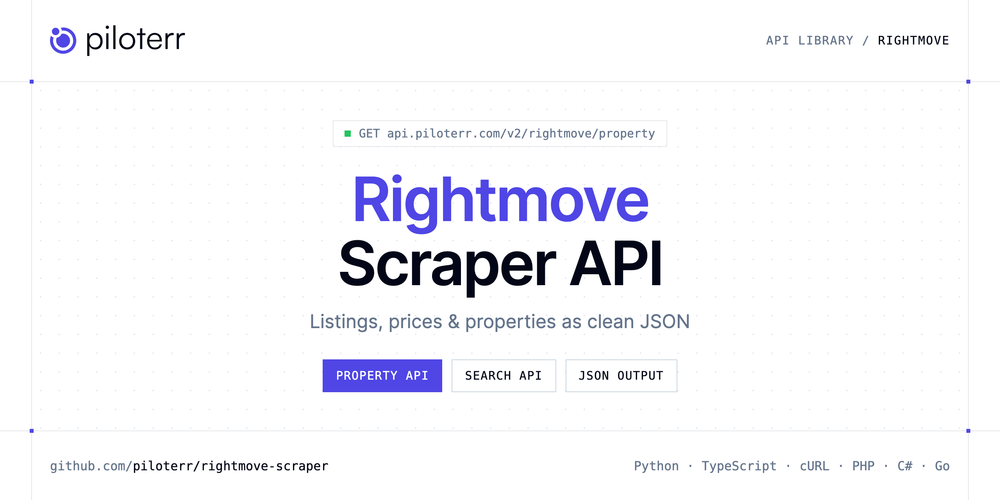

<p align="center">
  <a href="https://www.piloterr.com"></a>
</p>

# Rightmove Scraper API

[](https://discord.gg/CFj3ph8aHU) [](https://app.piloterr.com) [](https://app.piloterr.com/openapi) [](LICENSE)

The **Piloterr Rightmove Scraper API** lets you extract public data from Rightmove as **clean, structured JSON** — no proxies, headless browsers or HTML parsing to maintain. Endpoints available in production:

- **Rightmove Property API** — Read one Rightmove property from its URL or numeric id.
- **Rightmove Search API** — Search Rightmove by a UK place name or a search URL.

Use it for property price monitoring, market analytics, investment sourcing or rental yield models.

| Endpoint | Path | Credits | What you get |
|---|---|---|---|
| [Rightmove Property API](#rightmove-property-api) | `/v2/rightmove/property` | 2 | Read one Rightmove property from its URL or numeric id. The response is a flat object with price, tenure, floor area, stations, and the agent. |
| [Rightmove Search API](#rightmove-search-api) | `/v2/rightmove/search` | 2 | Search Rightmove by a UK place name or a search URL. Each card has a numeric price, a price label rebuilt from that number, the address, the agent, and a property URL. |

## Table of contents

- [How it works](#how-it-works)
- [Rightmove Property API](#rightmove-property-api)
- [Rightmove Search API](#rightmove-search-api)
- [Code examples in other languages](#code-examples-in-other-languages)
- [Practical use cases](#practical-use-cases)
- [Why Piloterr?](#why-piloterr)
- [FAQ](#faq)
- [Related scrapers](#related-scrapers)
- [Support](#support)

## How it works

1. **Create a free Piloterr account** and copy your API key from the [dashboard](https://app.piloterr.com).
2. **Send a `GET` (or `POST`) request** to `https://api.piloterr.com/v2/...` with the header `x-api-key: YOUR_API_KEY`.
3. **Receive structured JSON** — Piloterr handles rendering, proxies, retries and parsing.

```bash
export PILOTERR_API_KEY="your-api-key"
pip install requests        # Python
# TypeScript: Node.js 18+ (native fetch), run with `npx tsx file.ts`
```

> Every endpoint accepts both `GET` (query string) and `POST` (JSON body with the same fields).

## Rightmove Property API

Read one Rightmove property from its URL or numeric id. The response is a flat object with price, tenure, floor area, stations, and the agent.

`GET | POST https://api.piloterr.com/v2/rightmove/property` · **2 credits per request** · [Full reference](https://app.piloterr.com/openapi)

### Request parameters

| Parameter | Type | Required | Description |
|---|---|---|---|
| `query` | string | ✅ | Rightmove property URL or the numeric id. |
| `return_page_source` | boolean | — | Optional. Default false. |

### Python example

```python
import json
import os
import requests

response = requests.get(
    "https://api.piloterr.com/v2/rightmove/property",
    headers={"x-api-key": os.environ["PILOTERR_API_KEY"]},
    params={
        "query": "https://www.rightmove.co.uk/properties/172438235",
    },
    timeout=60,
)
response.raise_for_status()
data = response.json()

print(json.dumps(data, indent=2, ensure_ascii=False)[:2000])
```

### TypeScript example

```typescript
type RightmoveProperty = {
  id?: number;
  url?: string;
  agent?: {
    url?: string;
    logo?: string;
    name?: string;
    phone?: string;
  };
  price?: number;
  title?: string;
  images?: string[];
  tenure?: string;
  address?: string;
  channel?: string;
  summary?: string;
  bedrooms?: number;
  currency?: string;
  latitude?: number;
  postcode?: string;
  bathrooms?: number;
  longitude?: number;
  published?: boolean;
  floorplans?: string[];
  description?: string;
  country_code?: string;
  key_features?: string[];
  price_display?: string;
  property_type?: string;
  floor_area_sqm?: number;
  listing_update?: string;
  [key: string]: unknown;
};

const params = new URLSearchParams({
  "query": "https://www.rightmove.co.uk/properties/172438235",
});

const response = await fetch(`https://api.piloterr.com/v2/rightmove/property?${params}`, {
  headers: { "x-api-key": process.env.PILOTERR_API_KEY! },
});
if (!response.ok) throw new Error(`Piloterr error ${response.status}: ${await response.text()}`);

const data = (await response.json()) as RightmoveProperty;

console.log(JSON.stringify(data, null, 2).slice(0, 2000));
```

<details>
<summary><b>POST variant</b></summary>

```http
POST https://api.piloterr.com/v2/rightmove/property
x-api-key: YOUR_API_KEY
Content-Type: application/json

{"query": "https://www.rightmove.co.uk/properties/172438235"}
```
</details>

### Output example

Example response from the API reference, abridged — real values depend on the page you scrape.

```json
{
  "id": 172438235,
  "url": "https://www.rightmove.co.uk/properties/172438235",
  "agent": {
    "url": "example",
    "logo": "example",
    "name": "example",
    "phone": "example"
  },
  "price": 415000,
  "title": "2 bedroom apartment for sale in Upper Richmond Road, London, SW15",
  "images": [
    "https://media.rightmove.co.uk/property-photo/4bf25c0d8/172438235/4bf25c0d8416e36a76dab44d47d9b6db.jpeg",
    "https://media.rightmove.co.uk/property-photo/bf7743c77/172438235/bf7743c77a6ee8e0c192d0b506574601.jpeg"
  ],
  "tenure": "LEASEHOLD",
  "address": "Upper Richmond Road, London, SW15",
  "channel": "RES_BUY",
  "summary": "2 bedroom apartment",
  "bedrooms": 2,
  "currency": "GBP",
  "latitude": 51.463123,
  "postcode": "SW15 6TP",
  "bathrooms": 1,
  "longitude": -0.226337,
  "published": true,
  "floorplans": [
    "https://media.rightmove.co.uk/property-floorplan/67a75dd94/172438235/67a75dd94f8c38272d40a8d7fea9c9f5.jpeg"
  ],
  "description": "This well-presented two-bedroom flat is situated on the third floor of an attractive Art Deco, purpose-built mansion block and is served …",
  "country_code": "GB",
  "key_features": [
    "Two Bedrooms",
    "Kitchen/Reception/Dining Room"
  ],
  "price_display": "£415,000",
  "property_type": "Apartment",
  "floor_area_sqm": 63,
  "listing_update": "Reduced today"
}
```

### Response fields

| Field | Type | Description |
|---|---|---|
| `id` | integer |  |
| `url` | string |  |
| `agent` | object |  |
| `agent.url` | string |  |
| `agent.logo` | string |  |
| `agent.name` | string |  |
| `agent.phone` | string |  |
| `price` | integer |  |
| `title` | string |  |
| `images` | string[] |  |
| `tenure` | string |  |
| `address` | string |  |
| `channel` | string |  |
| `summary` | string |  |
| `bedrooms` | integer |  |
| `currency` | string |  |
| `latitude` | number |  |
| `postcode` | string |  |
| `bathrooms` | integer |  |
| `longitude` | number |  |
| `published` | boolean |  |
| `floorplans` | string[] |  |
| `description` | string |  |
| `country_code` | string |  |
| `key_features` | string[] |  |

## Rightmove Search API

Search Rightmove by a UK place name or a search URL. Each card has a numeric price, a price label rebuilt from that number, the address, the agent, and a property URL.

`GET | POST https://api.piloterr.com/v2/rightmove/search` · **2 credits per request** · [Full reference](https://app.piloterr.com/openapi)

### Request parameters

| Parameter | Type | Required | Description |
|---|---|---|---|
| `query` | string | ✅ | UK place name or a Rightmove search URL. |
| `page` | number | — | Results page, from 1. |
| `return_page_source` | boolean | — | Optional. Default false. |

### Python example

```python
import json
import os
import requests

response = requests.get(
    "https://api.piloterr.com/v2/rightmove/search",
    headers={"x-api-key": os.environ["PILOTERR_API_KEY"]},
    params={
        "query": "Bristol",
    },
    timeout=60,
)
response.raise_for_status()
data = response.json()

print(json.dumps(data, indent=2, ensure_ascii=False)[:2000])
```

### TypeScript example

```typescript
type RightmoveSearch = {
  results?: {
    id?: number;
    url?: string;
    agent?: {
      url?: string;
      name?: string;
      phone?: string;
    };
    image?: string;
    price?: number;
    tenure?: string;
    address?: string;
    channel?: string;
    summary?: string;
    bedrooms?: number;
    currency?: string;
    featured?: boolean;
    latitude?: number;
    bathrooms?: number;
    longitude?: number;
    floor_area?: string;
    image_count?: number;
    key_features?: string[];
    price_display?: string;
    property_type?: string;
    listing_update?: string;
    price_frequency?: unknown;
    price_qualifier?: unknown;
    transaction_type?: string;
  }[];
  pagination?: {
    next?: string;
    page?: number;
    per_page?: number;
    total_pages?: number;
    total_results?: number;
  };
};

const params = new URLSearchParams({
  "query": "Bristol",
});

const response = await fetch(`https://api.piloterr.com/v2/rightmove/search?${params}`, {
  headers: { "x-api-key": process.env.PILOTERR_API_KEY! },
});
if (!response.ok) throw new Error(`Piloterr error ${response.status}: ${await response.text()}`);

const data = (await response.json()) as RightmoveSearch;

console.log(JSON.stringify(data, null, 2).slice(0, 2000));
```

<details>
<summary><b>POST variant</b></summary>

```http
POST https://api.piloterr.com/v2/rightmove/search
x-api-key: YOUR_API_KEY
Content-Type: application/json

{"query": "Bristol"}
```
</details>

### Output example

Example response from the API reference, abridged — real values depend on the page you scrape.

```json
{
  "results": [
    {
      "id": 94960389,
      "url": "https://www.rightmove.co.uk/properties/94960389",
      "agent": {
        "url": "example",
        "name": "example",
        "phone": "example"
      },
      "image": "https://media.rightmove.co.uk/dir/crop/10:9-16:9/property-photo/2451b1f09/94960389/2451b1f09818a2091af4d44c668814d9_max_476x317.jpeg",
      "price": 550000,
      "tenure": "SHARE_OF_FREEHOLD",
      "address": "Talbot Road, Notting Hill, London, W2",
      "channel": "BUY",
      "summary": "Talbot Road is one of the most desirable streets in the area, positioned between the vibrant neighbourhoods of Notting Hill and Bayswater…",
      "bedrooms": 1,
      "currency": "GBP",
      "featured": false,
      "latitude": 51.517913,
      "bathrooms": 1,
      "longitude": -0.193037,
      "floor_area": "389 sq. ft.",
      "image_count": 8,
      "key_features": [
        "One bedroom apartment",
        "Private balcony"
      ],
      "price_display": "£550,000",
      "property_type": "Flat",
      "listing_update": "Added today",
      "price_frequency": null,
      "price_qualifier": null,
      "transaction_type": "buy"
    }
  ],
  "pagination": {
    "next": "https://www.rightmove.co.uk/property-for-sale/London-87490.html?index=24",
    "page": 1,
    "per_page": 24,
    "total_pages": 42,
    "total_results": 59708
  }
}
```

### Response fields

| Field | Type | Description |
|---|---|---|
| `results[]` | object[] |  |
| `results[].id` | integer |  |
| `results[].url` | string |  |
| `results[].agent` | object |  |
| `results[].image` | string |  |
| `results[].price` | integer |  |
| `results[].tenure` | string |  |
| `results[].address` | string |  |
| `results[].channel` | string |  |
| `results[].summary` | string |  |
| `results[].bedrooms` | integer |  |
| `results[].currency` | string |  |
| `results[].featured` | boolean |  |
| `results[].latitude` | number |  |
| `results[].bathrooms` | integer |  |
| `results[].longitude` | number |  |
| `results[].floor_area` | string |  |
| `results[].image_count` | integer |  |
| `results[].key_features` | string[] |  |
| `results[].price_display` | string |  |
| `results[].property_type` | string |  |
| `results[].listing_update` | string |  |
| `results[].price_frequency` | object |  |
| `results[].price_qualifier` | object |  |
| `results[].transaction_type` | string |  |

## Code examples in other languages

Ready-to-run examples live in the [`examples/`](examples) folder. Each one reads your key from the `PILOTERR_API_KEY` environment variable.

| Language | Property | Search |
|---|---|---|
| cURL (Bash) | [`property`](examples/curl/property.sh) | [`search`](examples/curl/search.sh) |
| PHP | [`property`](examples/php/property.php) | [`search`](examples/php/search.php) |
| C# | [`property`](examples/csharp/Property.cs) | [`search`](examples/csharp/Search.cs) |
| Go | [`property`](examples/go/property.go) | [`search`](examples/go/search.go) |
| Java | [`property`](examples/java/PropertyExample.java) | [`search`](examples/java/SearchExample.java) |
| Ruby | [`property`](examples/ruby/property.rb) | [`search`](examples/ruby/search.rb) |
| Node.js | [`property`](examples/nodejs/property.mjs) | [`search`](examples/nodejs/search.mjs) |

## Practical use cases

- **Price monitoring** — Track asking prices and price drops per area.
- **Market analytics** — Measure inventory, days on market and price per m² / sqft.
- **Investment sourcing** — Detect undervalued properties as soon as they are listed.
- **Rental yield models** — Combine sale and rent listings to estimate yields.
- **Proptech products** — Power portals, valuation tools and alerts with structured listings.

## Why Piloterr?

- **No infrastructure** — no proxies, headless browsers or CAPTCHA solving to run yourself.
- **Structured JSON** — stable, documented fields instead of brittle HTML selectors.
- **Pay per request** — transparent credit cost per endpoint, failed requests are retried for you.
- **One API key, hundreds of sources** — Rightmove plus many other e-commerce, search and company data endpoints in the [Piloterr library](https://www.piloterr.com/library).
- **Any language** — plain HTTPS + JSON, with examples for Python, TypeScript, cURL, PHP, C#, Go, Java, Ruby and Node.js.

## FAQ

### Is it legal to scrape Rightmove?

Collecting publicly available data is generally allowed in many jurisdictions, but rules depend on your country, the data you collect and how you use it. Avoid personal data unless you have a lawful basis, respect the website's terms where they apply, and get legal advice for your specific use case. This is not legal advice.

### Do I need proxies or a headless browser?

No. Piloterr handles rendering, proxy rotation and retries on its side. You only send an HTTPS request with your `x-api-key` header and receive JSON.

### How much does a request cost?

Credits per call: `/v2/rightmove/property` **2**, `/v2/rightmove/search` **2**. See the [Piloterr website](https://www.piloterr.com) for plans.

### What data does the Rightmove API return?

Each endpoint returns structured JSON: **Rightmove Property** — `id`, `url`, `agent`, `agent.url`, `agent.logo`, `agent.name`; **Rightmove Search** — `results[]`, `results[].id`, `results[].url`, `results[].agent`, `results[].image`, `results[].price`.

### How do I paginate Rightmove results?

Use the `page` parameter and keep requesting while the response indicates more results.

### Can I get the raw HTML instead of JSON?

Yes. Set `return_page_source=true` and the response becomes `{"result": "..."}` with the page source.

### Which languages are supported?

Any language that can make an HTTP request. This README shows Python and TypeScript; the [`examples/`](examples) folder contains cURL, PHP, C#, Go, Java, Ruby and Node.js.

## Related scrapers

- [Apartments Scraper API](https://github.com/piloterr/apartments-scraper)
- [Argenprop Scraper API](https://github.com/piloterr/argenprop-scraper)
- [Centris Scraper API](https://github.com/piloterr/centris-scraper)
- [Domain.com.au Scraper API](https://github.com/piloterr/domaincomau-scraper)
- [Fotocasa Scraper API](https://github.com/piloterr/fotocasa-scraper)
- [Funda Scraper API](https://github.com/piloterr/funda-scraper)
- [All Piloterr scrapers on GitHub](https://github.com/piloterr)

## Support

- 💬 Join the [Piloterr Discord](https://discord.gg/CFj3ph8aHU) to ask questions and share what you build.
- 📚 Browse the [API reference (OpenAPI)](https://app.piloterr.com/openapi) and the [Piloterr library](https://www.piloterr.com/library).
- 🔑 [Get your API key](https://app.piloterr.com).

---

<p align="center">
  <a href="https://www.piloterr.com">
    <picture>
      <source media="(prefers-color-scheme: dark)" srcset="images/logo-dark.svg">
      
    </picture>
  </a>
  <br>
  <sub>Built by <a href="https://www.piloterr.com">Piloterr</a> — web scraping APIs for e-commerce, search, real estate and more, one API key.</sub>
</p>

<sub>Rightmove is a trademark of its respective owner. This repository is not affiliated with or endorsed by Rightmove. Examples are released under the MIT license.</sub>
